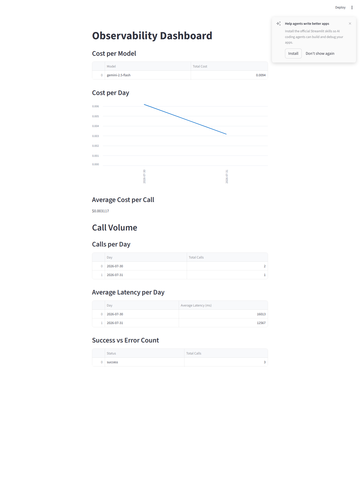

# LLM Observability Platform

Per-call visibility into LLM API usage: **how often it's called, how fast it responds, and what it costs.** Built with Kafka, Redis, SQLite and Streamlit, instrumenting the Gemini API.

If you call an LLM API from production code, the provider gives you an aggregate usage page and not much else. This project builds the missing layer: every call is captured as a structured event, deduplicated, priced from its token counts, stored, and shown on a dashboard.

> **Status: working MVP running on localhost.** Cost and call-volume monitoring are built. Quality scoring and alerting are not. See [Known limitations](#known-limitations).

---

## The three questions

The platform was designed around three questions about an LLM-powered application.

| Question                                                        | Status                                                      |
| --------------------------------------------------------------- | ----------------------------------------------------------- |
| How many times is the API called, and how fast does it respond? | Built (Call Volume panel)                                   |
| What does it cost, per model and per day?                       | Built (Cost panel)                                          |
| Are the responses actually good?                                | Not built yet (see [Known limitations](#known-limitations)) |

---

## Dashboard



_Demo data: a handful of real Gemini calls sent through the full pipeline. The dashboard reads straight from SQLite and updates on every refresh._

---

## How it works

```
gemini_call_instrumented(prompt)      wraps the Gemini call, returns a 9-field event
        │
        ▼
Kafka topic: llm.request.completed.v1
        │
        ▼
Consumer
  ├─ Redis check on request_id        skips duplicate events from retries
  ├─ calculate_cost()                 token counts × per-model price table
  └─ INSERT into SQLite (llm_events)
        │
        ▼
queries.py  →  Streamlit dashboard
```

**Instrumentation lives outside the application.** The app calls the Gemini API as it always did. A wrapper around the client measures each call, so the metrics can't be corrupted by the app reporting on itself, and measurement can change without touching application code.

**Every call produces the same event shape,** whether it succeeded or failed. That consistent schema is what lets every later stage stay simple.

### Repository layout

| File                 | Role                                                                    |
| -------------------- | ----------------------------------------------------------------------- |
| `gemini_client.py`   | Instrumented wrapper around the Gemini API (`gemini_call_instrumented`) |
| `producer.py`        | Publishes events to Kafka                                               |
| `consumer.py`        | Reads events, deduplicates via Redis, enriches with cost, stores them   |
| `cost_calculator.py` | Per-model price table and cost calculation                              |
| `storage.py`         | SQLite schema and writes                                                |
| `queries.py`         | SQL queries behind each dashboard panel                                 |
| `app.py`             | Streamlit dashboard                                                     |

This repo contains the instrumentation wrapper and a test script that generates real calls. It does not include an LLM application; the wrapper is meant to sit in front of whatever calls Gemini.

---

## Quickstart

**Prerequisites:** Python 3.10+, a Kafka broker on `localhost:9092`, Redis on `localhost:6379`, and a Gemini API key.

```bash
git clone https://github.com/Padmasree09/kafka_project.git
cd kafka_project

python -m venv .venv
source .venv/bin/activate          # Windows: .venv\Scripts\activate
pip install -r requirements.txt

cp .env.example .env               # then add your GEMINI_API_KEY
```

Run each in its own terminal:

```bash
python consumer.py                 # 1. start the consumer
python producer.py                 # 2. send a test call through the pipeline
streamlit run app.py               # 3. open the dashboard
```

---

## Design decisions

- **Kafka over direct database writes.** The publish is asynchronous, so the user's response never waits on observability infrastructure. Raw events also stay in the topic (within the retention window), so a new metric can be computed later by replaying history. The cost is real operational complexity; for a single-developer MVP a database queue would also work, and I chose Kafka for replayability.
- **Redis for deduplication.** An in-memory set would silently forget everything on a consumer restart. Redis keeps `request_id` checks durable so retries don't double-count cost.
- **SQLite for storage.** One file, zero configuration, enough for this stage. Swapping it out is a change to the storage layer, not a pipeline rebuild.
- **Streamlit for the dashboard.** Python end to end, no frontend code.

The original seven-layer design, including the pieces not yet built, is in [`docs/design.md`](docs/design.md).

---

## Known limitations

This is an MVP, and these are the gaps between it and something you'd run at scale:

- **No quality scoring.** Cost and latency are objective; "is this response good?" is not. The plan is LLM-as-a-judge scoring with a rubric, run asynchronously so it never blocks a response. Judge scores are signals, not ground truth, so this needs calibration against human labels to be trusted.
- **No schema validation at the Kafka boundary.** A malformed event can currently get through. A schema registry with Avro would reject it at publish time.
- **SQLite is not built for this at scale.** The latency and cost queries are fine for small data. At millions of rows you'd want a time-series database (TimescaleDB, InfluxDB) for latency and a warehouse for historical cost.
- **No alerting.** Cost-per-hour, error-rate and latency thresholds were designed but are not wired up.
- **Latency is shown as an average.** Averages hide slow outliers; p95/p99 are not yet computed.
- **Prices are hardcoded.** The pricing table in `cost_calculator.py` reflects Gemini pricing at the time of writing. Check it against current pricing before trusting the cost numbers.

---

## Further reading

I wrote the build up as a seven-part series: [Read it on Medium](https://medium.com/@padmasree.91004/designing-an-observability-platform-for-a-gemini-powered-ai-agent-1e8104b1dfe6).
